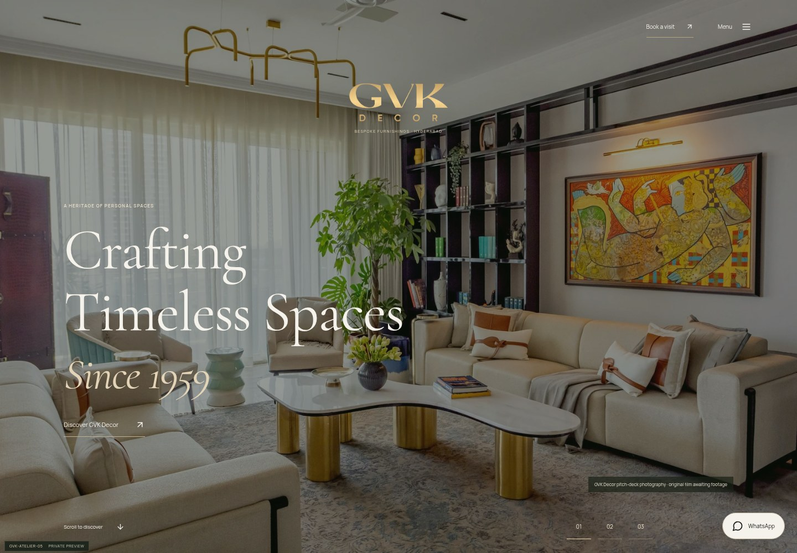
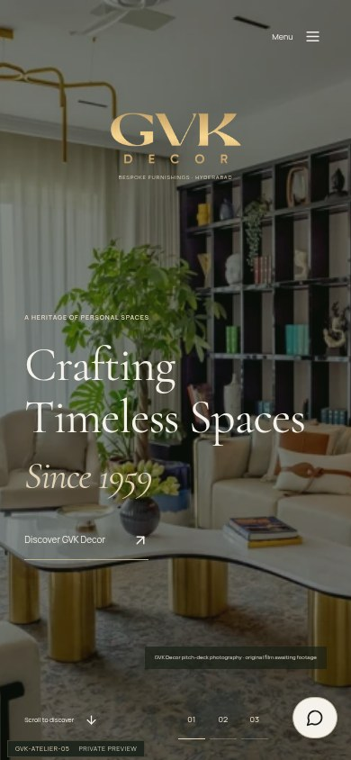
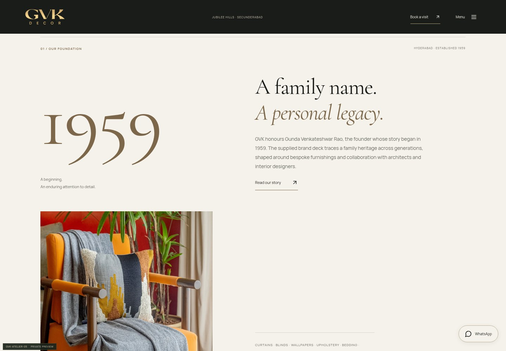
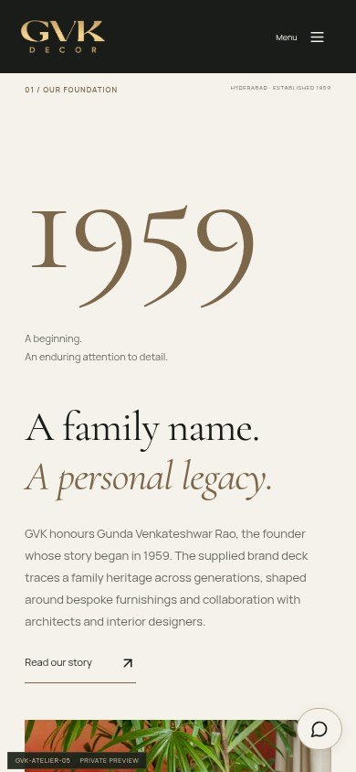
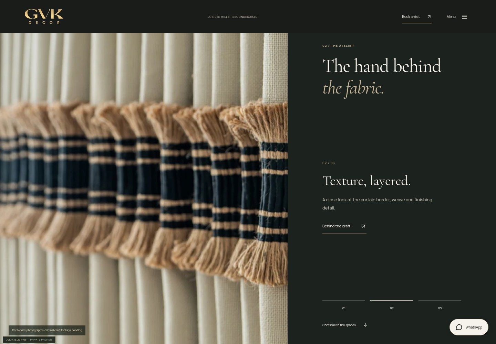
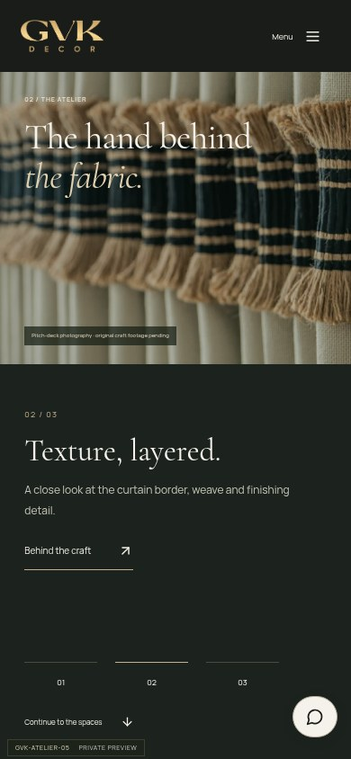
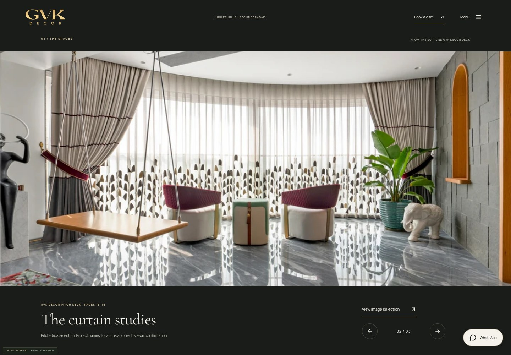
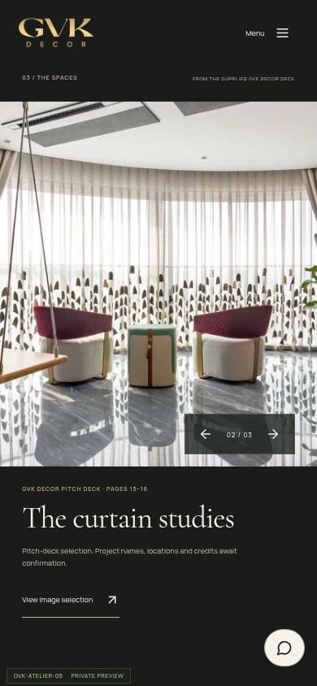
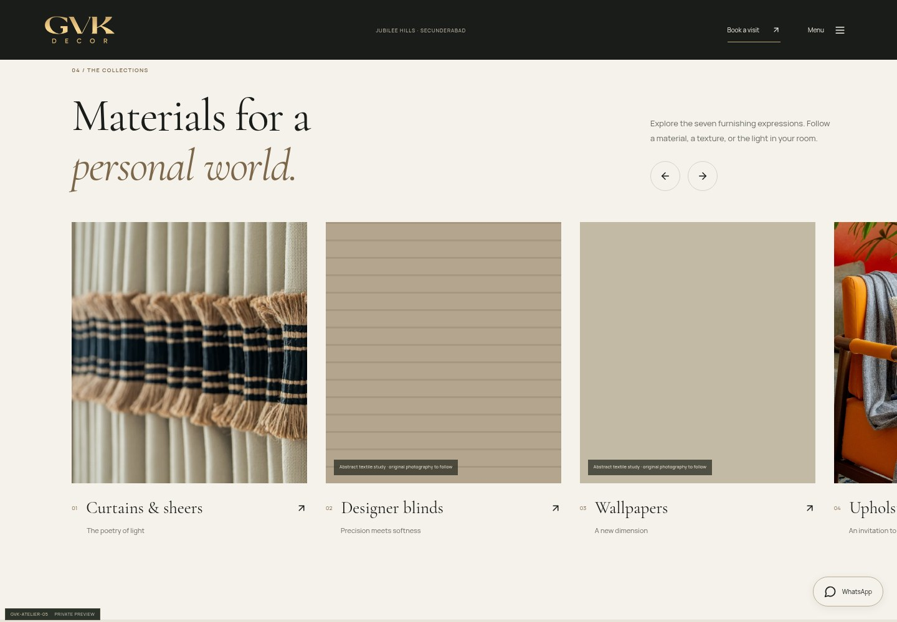
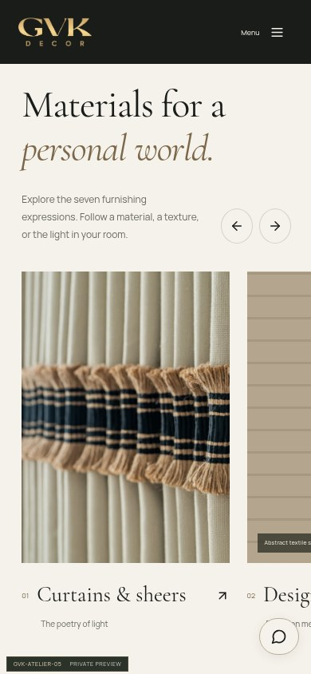

# Current design review — GVK-ATELIER-05

Actual local browser captures at 1440×1000 and 390×844. The still photographs and
logo are extracted from the supplied GVK Decor pitch deck. No inaccessible Drive
video is represented as reviewed footage. Previous revision screenshots remain
in Git history; use the Atelier 05 images below for the current design.

## Browser motion recording

[Download or open the 16-second browser walkthrough](atelier-05/browser-walkthrough.mp4?raw=1).
This is a screen recording of the website using deck stills, not original project
footage or a proposed GVK Decor brand film.

## Opening

## Heritage and 1959 spacing

## Middle — the atelier

## Portfolio — the spaces

## Collection exhibition

For motion, run the private [Windows preview](../WINDOWS-PREVIEW.md). A screenshot
cannot demonstrate movement; the [motion review](../MOTION-REVIEW.md) describes
what to look for. Look for GVK-ATELIER-05 in the local browser.
