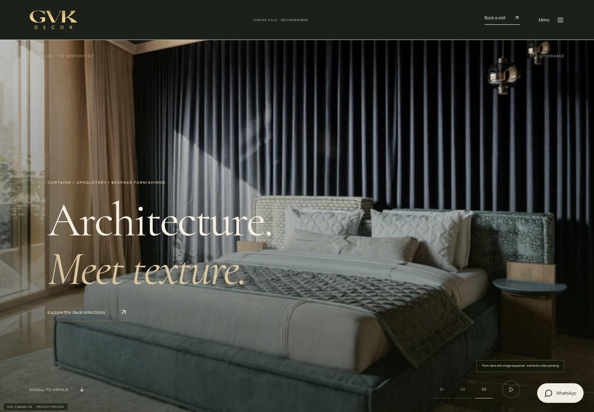
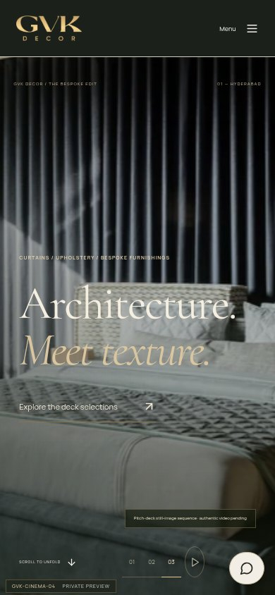
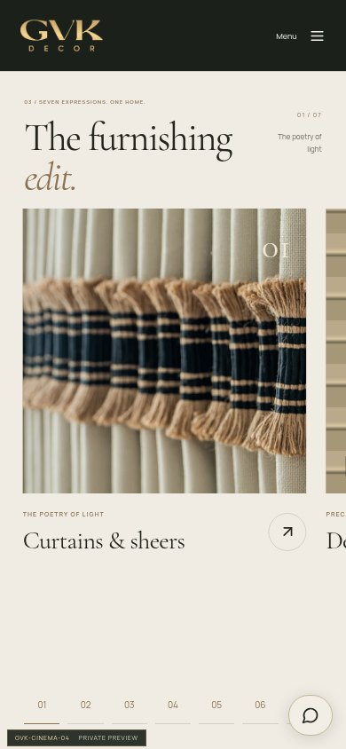
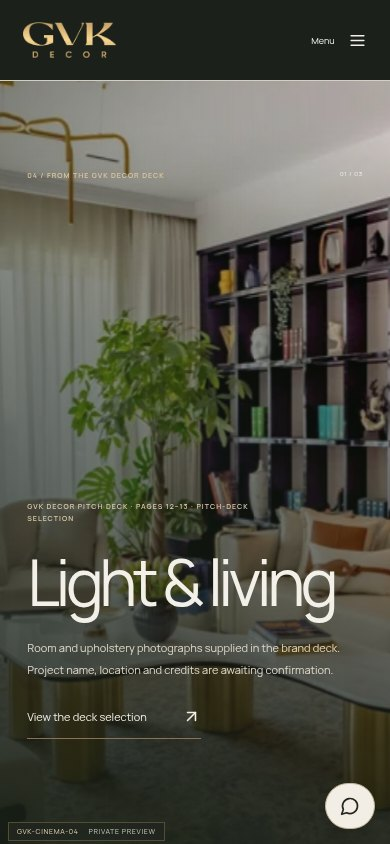

# GVK-CINEMA-04 browser screenshots

Actual local Chrome/Chromium captures at 1440×1000 (desktop) and 390×844 (mobile).
These are still screenshots of the website, not claims of reviewed project video.
The opening uses labelled pitch-deck photographs while Drive access is blocked.

## Desktop — first frame

## Desktop — after scrolling through the aperture

## Desktop — horizontal furnishing edit

## Desktop — overlapping portfolio frame

## Mobile — first frame

## Mobile — expanded opening

## Mobile — furnishing edit

## Mobile — portfolio frame

For an interactive review, download a fresh main ZIP and follow
[the Windows preview guide](../WINDOWS-PREVIEW.md). Look for GVK-CINEMA-04 in the
browser so an old server/ZIP cannot be mistaken for this version.
